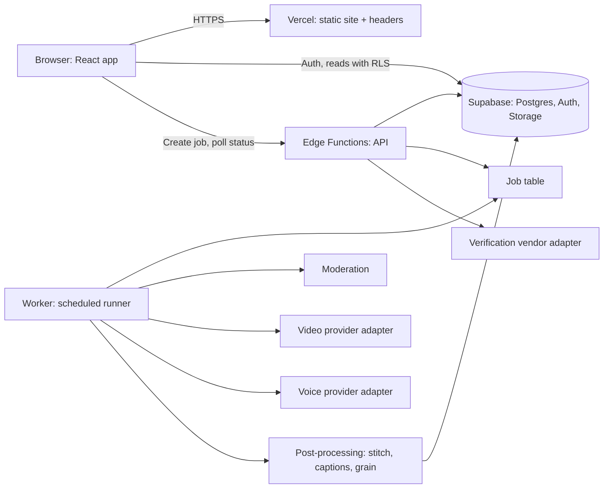
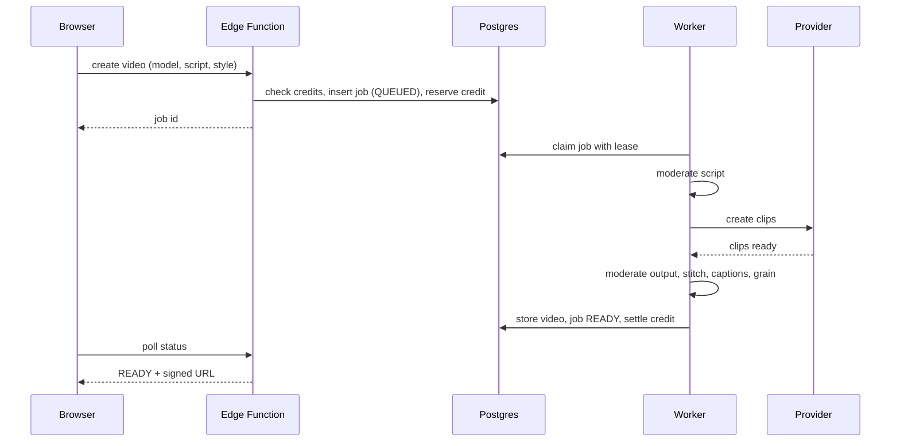

# Architecture

*Last updated: 13 Oct 2026. Status: proposed. The prototype runs the front end only.*

## The picture



In words: the browser is a static React app. It talks to Supabase directly for sign-in and for reading its own rows (row-level security does the guarding). Anything that costs money or touches a secret goes through a server function. Slow work, mainly video, happens in a worker that reads a job table, so a closed browser tab doesn't kill a render.

## Parts and what each one owns

**React app (Vercel).** Pages, components, theming, motion. It never holds a secret and never decides who owns what. It asks.

**Supabase Auth.** Accounts, sessions, Google sign-in, email verification, password reset. We don't write password handling ourselves.

**Supabase Postgres.** The single source of truth for users, models, twins, consents, videos, jobs, credits and audit logs. Row-level security on every table.

**Supabase Storage.** Private buckets for twin uploads and generated videos. Public bucket only for approved model preview media. Access is by short-lived signed URLs.

**Edge Functions (the API).** Small functions: create a job, check a job, start twin creation, record consent, delete a twin, issue a signed URL. They check the user, check credits, write rows, and return fast.

**Worker.** A scheduled function (cron-style) that picks up queued jobs, claims them with a lease, runs the pipeline, and writes results. It is the only thing that calls the video and voice providers.

**Provider adapters.** One interface per external service, with a mock and a real version. The code above the adapter doesn't know which one it has.

## Why this stack

We want the shortest path from the AI Studio export to a deployed product, and it's the same route Task 1 (PostPilot) takes: GitHub, Supabase, Vercel. One mental model for both projects is worth a lot when one person is building them.

Alternatives we considered:

| Option | Why not (for now) |
|---|---|
| Next.js with server routes | A better long-term fit for server work, but moving the export to Next costs a week and buys little before Phase 3 |
| Separate FastAPI backend | Matches Task 1's earlier design but adds a server to run, patch and pay for |
| Everything in the browser | Leaks keys and can't enforce limits. Ruled out |

If server logic grows past what Edge Functions handle comfortably (long jobs, heavy video work), the worker moves to a small container service. The adapters and tables stay the same.

## Adapter pattern and mock switches

```ts
// lib/api/video.ts  (shape, not final code)
export interface VideoProvider {
  createClip(input: { modelId: string; script: string; style: Style }): Promise<{ jobRef: string }>;
  getClip(jobRef: string): Promise<{ status: "pending" | "done" | "failed"; url?: string; error?: string }>;
}
```

`USE_MOCK_VIDEO=true` returns a pre-rendered clip after a fake delay. `false` calls the real provider. Same idea for voice, verification and auth. The UI should not change when you flip a switch. If it does, the adapter is leaking.

The mock should also be able to fail on demand (`MOCK_FAIL_RATE`), because error screens that were never triggered are broken screens.

## The main flows

### Generate a video



### Create a twin

Upload photos and voice (direct to a private bucket with signed upload URLs) → consent screen, record stored → liveness and face match through the vendor → status moves to PENDING_REVIEW or READY → owner can use it, nobody else can.

## Environments

| | Local | Preview | Production |
|---|---|---|---|
| Data | Seed data | Separate Supabase project | Production project |
| Providers | Mocks | Mocks, with a few real calls on request | Real |
| Secrets | `.env` (git-ignored) | Vercel preview vars | Vercel production vars |

Production and preview never share a database or a bucket. A test account in preview should never be able to touch real twin data.

## Performance targets

Largest contentful paint under 2.5 seconds on a mid-range phone over 4G. First-load JavaScript under 200 KB gzipped for the landing page (lazy-load the rest). Videos load on demand, `preload="none"` with a poster. Animations use transform and opacity only, and pause when off-screen.

## What changes between prototype and production

| Prototype | Production |
|---|---|
| `lib/auth.ts` mock | Supabase Auth |
| `lib/mock/*` | Tables plus API calls |
| Pre-rendered clip | Worker and provider |
| Fake progress bar | Real job status |
| Liveness animation | Vendor liveness check |
| Silhouette models | Real model packages (MODEL_SPEC.md) |

## Decisions to revisit

1. Edge Functions vs a container for the worker, after Phase 3 load tests.
2. Direct-to-provider uploads vs proxying through our storage. Direct is cheaper; proxying gives us a single place to scan.
3. Where to store face embeddings if the vendor returns them. Default answer: don't store them.
