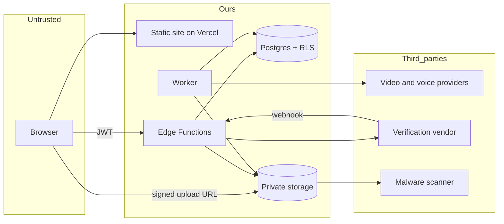

# Threat model

*Last updated: 13 Oct 2026. Method: STRIDE on the data flow below, plus an abuse-case pass because a digital-twin product has misuse risks that standard web checklists miss.*

Most of what follows is about the production design. The prototype has almost no attack surface because it has no backend.

## What we're protecting

1. People's faces and voices (twin assets). The worst thing to lose.
2. Accounts and sessions.
3. The ability to generate videos, which costs real money.
4. The reputation of the product: nobody should be able to use us to fake a person.
5. The hidden character prompts and model packages (business value).
6. The integrity of consent records, which are our proof.

## Who might attack, and why

| Actor | Wants | Skill |
|---|---|---|
| Opportunist | Free videos, free credits | Low |
| Impersonator | A convincing video of a specific real person | Low to medium |
| Scammer | Fake endorsements, fake testimonials at scale | Medium |
| Stalker or ex-partner | Someone's likeness without their knowledge | Low |
| Account thief | Sessions and stored twins | Medium |
| Competitor or scraper | Our models, prompts, samples | Medium |
| Malicious insider or a careless one | Browsing restricted data, leaking a key | Varies |
| Compromised dependency | Run code in our build or browser | High |

## Data flow and trust boundaries

Every arrow crossing from Untrusted into Ours, and every arrow leaving to a third party, is a place to check input, identity and size.

## Threats

Likelihood and impact are rough: H, M, L. "Planned" means the mitigation is designed but not built yet.

| ID | Threat (STRIDE) | Impact | Likelihood | Mitigation | Status |
|---|---|---|---|---|---|
| T1 | Spoofing: someone uploads another person's photos to make a twin of them | H | H | Liveness plus face match against uploads, manual review on any doubt, public-figure checks, takedown path | Planned |
| T2 | Spoofing: voice sample of a non-consenting person used to clone a voice | H | M | Voice sample must be captured in the same verified session as liveness (read a random phrase), no standalone voice uploads | Planned |
| T3 | Spoofing: account takeover through credential stuffing | H | M | Breached-password check, rate limits, captcha, MFA, session revocation | Planned |
| T4 | Tampering: user edits another user's twin or video (IDOR) | H | M | RLS plus server ownership checks, automated cross-user tests | Planned |
| T5 | Tampering: forged webhook marks a twin as verified | H | M | Signature and timestamp checks, event id dedupe, status changes only by the server | Planned |
| T6 | Tampering: malicious file upload (polyglot, oversized, bad metadata) | M | H | Signed upload limits, content sniffing, re-encode, malware scan | Planned |
| T7 | Repudiation: user says they never consented | M | M | Consent table with version, time, hashed IP, device, immutable once written | Planned |
| T8 | Info disclosure: public or guessable URL to a private file | H | M | Private buckets, random paths, 60-second signed URLs | Planned |
| T9 | Info disclosure: API keys end up in the front-end bundle (AI Studio exports do this by default) | H | H | Move provider calls server-side, `VITE_` rule, bundle scan in CI, rotate keys | Open |
| T10 | Info disclosure: personal data in logs or error pages | M | M | Log scrubbing rules, generic client errors, review of log lines | Planned |
| T11 | Info disclosure: the hidden character prompt leaks | L | M | Prompt stays server-side, view excludes the column | Planned |
| T12 | Info disclosure: face data sent to a provider that trains on it | H | L | Contract and plan checks, no training setting, vendor table in DATA_SECURITY | Planned |
| T13 | Denial of service: flood of generation requests burns the budget | H | H | Credits, per-user and daily caps, concurrency limit, provider spend cap and alerts | Planned |
| T14 | Denial of service: huge uploads fill storage | M | M | Per-file and per-user limits | Planned |
| T15 | Elevation: user reaches admin or service-role functions | H | L | Separate roles, MFA for admins, service key only on the server | Planned |
| T16 | Prompt injection: script text tries to override moderation or exfiltrate the hidden prompt | M | H | Delimit input, no tools for the model, output checks, stricter second pass | Planned |
| T17 | Supply chain: compromised or typosquatted package | H | M | Lockfile, pinned versions, audit, two-week cooldown on new releases, review AI-suggested packages | Planned |
| T18 | Client-side injection (XSS) through user text | M | M | Framework escaping, no raw HTML, strict CSP | Planned |
| T19 | Session theft through a malicious extension or shared device | M | M | Short sessions, sign-out everywhere, recent-sign-in for sensitive actions | Planned |
| T20 | Insider browses twin data | H | L | No routine access, audit on every access, MFA | Planned |
| T21 | Cost leak: a leaked provider key is used by someone else | H | M | Spending caps, key rotation, alerts on unusual usage | Planned |
| T22 | Deletion fails and data lingers | H | M | Delete job with retries, alerts, a storage check test | Planned |

## Abuse cases specific to this product

These don't show up in a normal web threat model, and they're the ones that could hurt people.

**Impersonation for fraud.** A scammer generates a "customer testimonial" using a model's face and a stolen brand name, or builds a twin of a real local celebrity. Controls: block scripts that name real people or brands in endorsement form, refuse public-figure twins, label every video, make reports easy and takedown fast.

**Non-consensual twins.** Someone builds a twin of an ex, a coworker or a stranger from social media photos. Controls: liveness and match requirements, owner-only use, and a rule that a twin's source files must come from the verification session, not just any upload. We accept that no check is perfect, so we also keep evidence to act on complaints.

**Sexual or harassing content.** Moderation blocks it on input and output. Twins carry the owner's content rules, and any report involving a real person's likeness is handled first.

**Political and health misinformation.** Block fabricated statements from real figures and unverified medical or financial claims. This is where the line between marketing and deception gets blurry, so cases go to humans.

**Minors.** Twin creation is 18+. A suspected minor in photos or video freezes the twin and goes to review. Anything touching child safety is reported and removed with no appeal queue.

**Model scraping.** Competitors download every sample. We watermark preview media lightly, rate limit the gallery, and accept that anything public can be copied. The valuable part, the hidden prompt and reference set, never leaves the server.

## Top risks, in plain language

Number one is T1 and T2 together. If the verification step is weak, the product becomes a tool for faking people. This one gets the most time, the best vendor we can afford, and a human review path.

Number two is T9. It's the easiest to fix and the most embarrassing if missed. Before the first deploy with a real key, check the built JavaScript for it.

Number three is T13. A bill is a security issue when it can be triggered by a stranger.

## Residual risk we're accepting for launch

- Some convincing fakes will pass a good liveness check. We rely on review, labels and takedown to limit harm.
- Provider-side safety filters will sometimes block legitimate scripts. We'd rather over-block at launch and loosen with data.
- Published sample videos can be copied. That's the cost of a public gallery.

Each accepted risk gets a named owner and a review date.

## Keeping this alive

Revisit when we add a provider, a new upload type, payments, or teams. Walk the table before every major release. After any incident, add a row.
